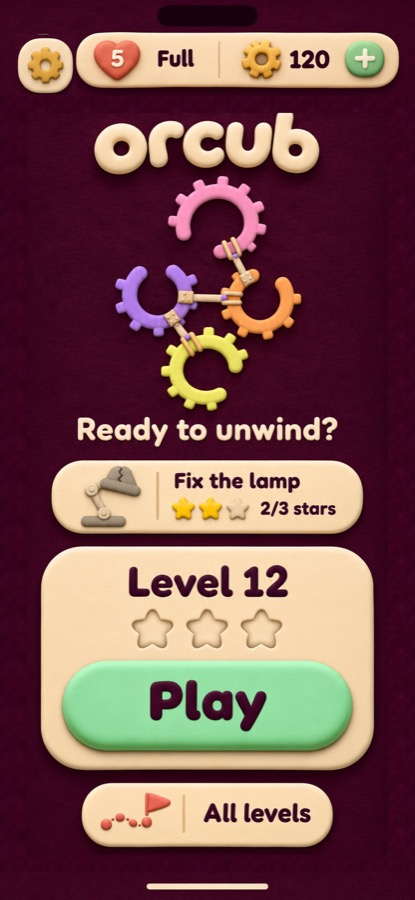
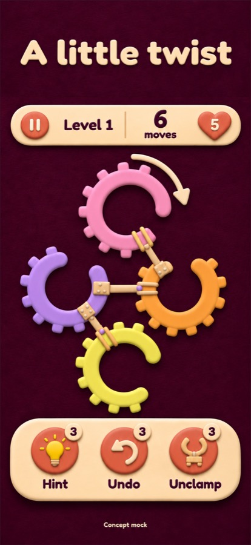
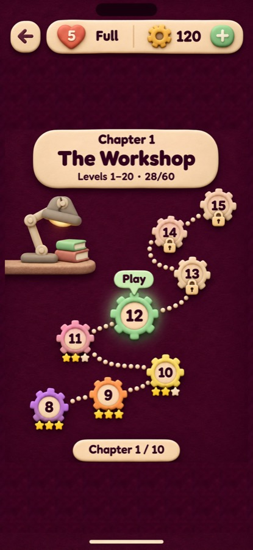
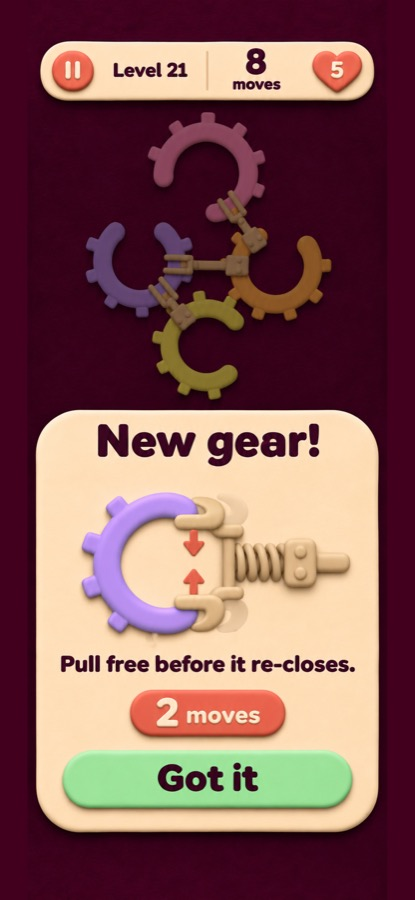
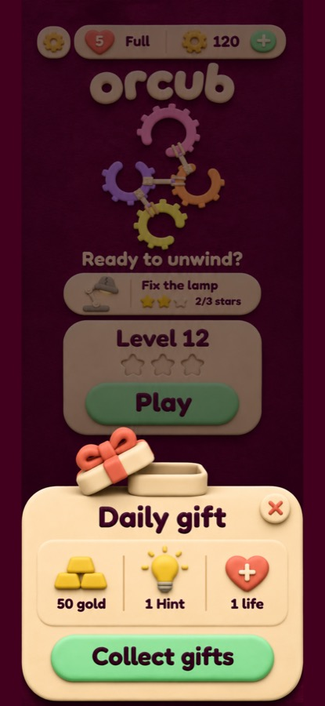
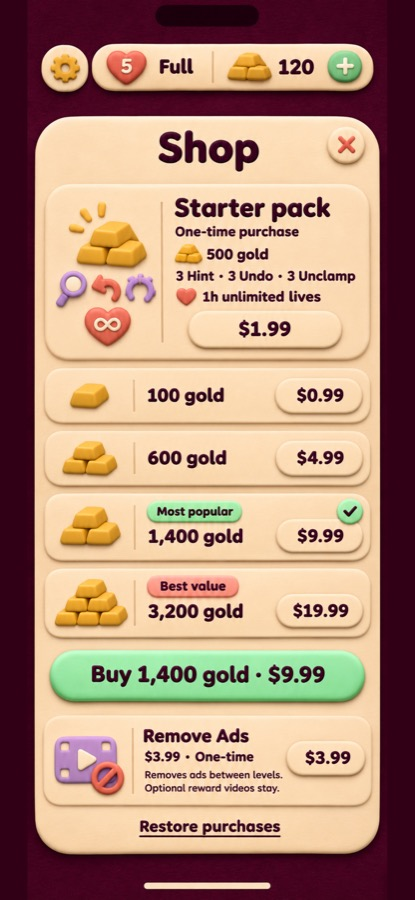

# Orcub: Gear Untangle Puzzle

**Turn. Release. Unwind.**

Orcub is a relaxing puzzle game for iPhone, played in portrait. The art is soft matte clay. Each level has C-shaped gear rings held together by little clamps. Rotate a ring until its gap slides past the clamp holding it. The clamp lets go, and you pull the free ring off the board. Clear the board before you run out of moves.

  
  
  

  
  
  

These are the approved design images each screen was built from, not captures from the device build.

## What's in the game

- **Endless levels in chapters.** Every 20th level is a boss level, with 14–18 rings and extra moves. Up to three stars per level for finishing in few moves.
- **New gear mechanics as you go:**
  - ratchets that turn one way only;
  - linked pairs that turn together;
  - colour clamps;
  - a key that opens a padlock;
  - rust that freezes a ring unless its oil is collected in time;
  - springs that close again;
  - clay coating that takes two passes.

  A card explains each mechanic the first time it appears.
- **Difficulty that adapts** to how each player is doing. What a player earns the game from ads never affects it.
- **Daily loop:** a daily gift, a daily puzzle and a win streak.
- **Helpers:** Hint, Undo and Unclamp, plus lives. Restarting a level costs a life.
- **Gentle on the senses.** Sound is kept sparse, and frequent actions only give a haptic tap.
- **Play as a guest or sign in with Google** to keep progress in the cloud. Guest progress merges into the account when you sign in. Sign in with Apple is planned.
- **Not built around ads.** Gold bars are the in-game currency. Rewarded ads are always optional. A one-time Remove Ads purchase turns off the ads between levels.

## How it's built

| Part | Where | Notes |
| --- | --- | --- |
| Game client | `Assets/Orcub` | Unity 6 (6000.6), URP 2D, iOS. The code lives in `Scripts/`, split into Core, Game, Net, Store, Ads, Daily and Features. |
| Backend | `backend/` | Rust (axum) with PostgreSQL, hosted on Railway. Its job is to be the final word on the wallet, rewards, daily features, cloud saves, account linking and deletion, and AdMob server-side reward checks. See [backend/README.md](backend/README.md). |
| Client ↔ server contract | [backend/clients/unity-contract.md](backend/clients/unity-contract.md) | The endpoints and payloads the game uses. |
| Gear mechanics | [ArtSource/mechanics/README.md](ArtSource/mechanics/README.md) | Rules and data format for each mechanic. |
| Art and UI designs | `ArtSource/` | Concept images, design briefs and logo work. |
| QA script | [scripts/qa/README.md](scripts/qa/README.md) | Runs the backend format check, lints and tests in one go. |

Ads come from Google AdMob. Debug and editor builds always use Google's test ad IDs. Firebase handles sign-in.

## Building

1. Open the project in Unity 6000.6.
2. Run **Orcub → Build iOS (Xcode project)**. It writes the Xcode project to `Builds/iOS-v2`.
3. Build and sign `Unity-iPhone.xcworkspace` in Xcode (or with `xcodebuild`), then install it on a device.

To run the backend locally and run its tests, see [backend/README.md](backend/README.md).

## Status

In development. The game is playable on iPhone. Still to come before App Store release: Sign in with Apple, real in-app purchases through App Store Connect, and a final performance pass on real devices.
